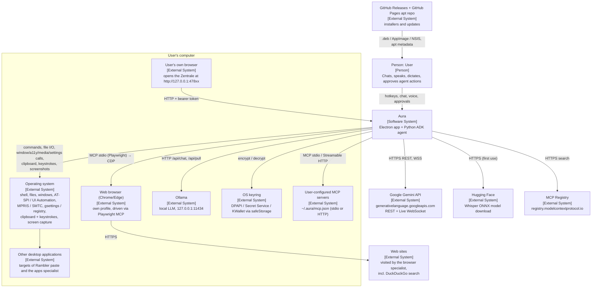

# Aura – System context (C4 level 1)

> Scope: what Aura is, who and what it talks to, and where the trust boundaries are.
> Inside view (processes, components, protocols): [overview.md](overview.md).
> Decisions: [docs/adr/](../adr/README.md). Jira story: AURA-28.

## What Aura is

Aura is an open-source desktop assistant. It is an **Electron app** ([src/main.js](../../src/main.js)) with a
**Python agent sidecar** built on Google ADK ([agent/](../../agent/), [ADR 0001](../adr/0001-python-adk-sidecar.md)).

| Feature | Short description | Main code |
|---|---|---|
| Chat panel | Compact overlay panel, optional screenshot of the current screen | [src/renderer/panel.js](../../src/renderer/panel.js), [src/main.js](../../src/main.js) |
| Voice dictation | Speech to text in the chat (local Whisper or Gemini) | `chat:transcribe` in [src/main.js](../../src/main.js), [src/renderer/stt.js](../../src/renderer/stt.js) |
| Live | Gemini Live (audio + screen over WebSocket) or a local Whisper → Ollama → speech loop | [src/renderer/live.js](../../src/renderer/live.js), [src/renderer/local-live.js](../../src/renderer/local-live.js) |
| Rambler | Dictate into *any* app: copy selection, record, rewrite, paste back | `toggleRambler` in [src/main.js](../../src/main.js), [src/keys.js](../../src/keys.js) |
| Agent | Acts on the PC (files, shell, apps, windows, media, settings, browser, MCP) with tiered approvals T0–T3 | [agent/src/aura_agent/](../../agent/src/aura_agent/) |
| Zentrale | Management UI (tools, MCP servers, skills, secrets, rules, memory, audit, doctor); as window or in the user's browser | [src/zentrale.js](../../src/zentrale.js), [src/web.js](../../src/web.js) |

Tiers ([harness/tiers.py](../../agent/src/aura_agent/harness/tiers.py)): **T0** read – runs; **T1** local and
reversible – runs; **T2** consequential – always asks the user; **T3** forbidden (credentials, security) – never runs.

Model providers: **local** via Ollama (no data leaves the machine) or **Google Gemini** (API key). Selected by
`provider` in `settings.json`.

## Context diagram

## External interfaces

Direction is seen from Aura (→ outgoing, ← incoming). Trust: **trusted** = controlled by the user or the OS and
treated as authoritative; **untrusted** = content may be adversarial and is treated as data only.

| Neighbour | Dir. | Data exchanged | Protocol / transport | Trust | Code |
|---|---|---|---|---|---|
| User | ← → | Hotkeys, chat text, audio, approvals (`once`/`task`/`always`/`deny`), answers to `ask_user` | Electron windows, global shortcuts, tray, CLI args (`--toggle`, `--live`, …) | trusted | [src/main.js](../../src/main.js), [src/preload.js](../../src/preload.js) |
| OS: shell | → | Commands and output (bash / PowerShell) | child processes in own process group | trusted (output is tainted) | [tools/shell.py](../../agent/src/aura_agent/tools/shell.py), [platform/proc.py](../../agent/src/aura_agent/platform/proc.py) |
| OS: files | ← → | File contents, listings, trash | filesystem, `gio trash` / recycle bin | trusted (contents tainted) | [tools/files.py](../../agent/src/aura_agent/tools/files.py), [policy/paths.py](../../agent/src/aura_agent/policy/paths.py) |
| OS: windows | ← → | Window list, focus/min/max/close | X11 EWMH (python-xlib); GNOME Wayland D-Bus `org.aura.Bridge`; Win32 user32 | trusted | [platform/x11.py](../../agent/src/aura_agent/platform/x11.py), [platform/gnome_wayland.py](../../agent/src/aura_agent/platform/gnome_wayland.py), [platform/win32.py](../../agent/src/aura_agent/platform/win32.py) |
| OS: accessibility | ← → | UI trees, actions, text input | AT-SPI (helper with system `/usr/bin/python3` + PyGObject); UI Automation (helper with bundled Python + comtypes); line protocol over stdio | untrusted content | [platform/atspi.py](../../agent/src/aura_agent/platform/atspi.py), [platform/atspi_helper.py](../../agent/src/aura_agent/platform/atspi_helper.py), [platform/uia_helper.py](../../agent/src/aura_agent/platform/uia_helper.py) |
| OS: media, volume | ← → | Player status, play/pause/next, volume | MPRIS over D-Bus, `pactl`; Windows SMTC (winrt), Core Audio | trusted | [tools/system.py](../../agent/src/aura_agent/tools/system.py), [platform/win_media.py](../../agent/src/aura_agent/platform/win_media.py), [platform/win_audio.py](../../agent/src/aura_agent/platform/win_audio.py) |
| OS: settings | ← → | Dark mode, GNOME keys / Windows settings | `gsettings`; Windows registry | trusted | [tools/system.py](../../agent/src/aura_agent/tools/system.py), [tools/win_settings.py](../../agent/src/aura_agent/tools/win_settings.py), [platform/win_registry.py](../../agent/src/aura_agent/platform/win_registry.py) |
| OS: clipboard, keystrokes, mouse | → | Ctrl+C/V/Z for Rambler; click/type/keys for agent fallback | Electron `clipboard`; `xdotool` / `wtype` / `ydotool`; PowerShell SendKeys + user32 | trusted | [src/keys.js](../../src/keys.js), [src/agent/input.js](../../src/agent/input.js) |
| OS: screen capture | ← | JPEG of current display | Electron `desktopCapturer`; on Wayland a persistent screen-share stream in the panel | untrusted content | `screenshotJpeg` in [src/main.js](../../src/main.js), [src/renderer/screen-grab.js](../../src/renderer/screen-grab.js) |
| OS: notifications, autostart | → | "Aura is done" notifications; autostart entry | Electron `Notification`; `~/.config/autostart/aura.desktop` / login item | trusted | [src/main.js](../../src/main.js) |
| Other desktop apps | → / ← | Pasted text (Rambler); UI actions by the `apps` specialist | via clipboard/keystrokes and accessibility (above) | untrusted content | [src/main.js](../../src/main.js), [agents/specialists.py](../../agent/src/aura_agent/agents/specialists.py) |
| Web browser (Playwright MCP) | ← → | Navigate, snapshot, click, type, forms (13 allow-listed tools; no JS eval, no uploads) | MCP over stdio to `@playwright/mcp` (bundled, run with Electron as Node; dev: `npx`), Chrome/Edge with profile `~/.aura/browser-profile` | untrusted content | [tools/browser.py](../../agent/src/aura_agent/tools/browser.py), `browserLauncher` in [src/main.js](../../src/main.js), [ADR 0009](../adr/0009-browser-specialist.md) |
| Web sites (incl. DuckDuckGo) | ← → | Page content; search via `html.duckduckgo.com` | HTTPS from the controlled browser | **untrusted** (prompt injection) | [tools/browser.py](../../agent/src/aura_agent/tools/browser.py) |
| Ollama | → | Prompts, images, tool schemas; streamed answers; model list, model pull | HTTP to `http://127.0.0.1:11434` (`/api/chat`, `/api/generate`, `/api/tags`, `/api/pull`) | trusted endpoint, model output untrusted | [src/ollama.js](../../src/ollama.js), [models/ollama_llm.py](../../agent/src/aura_agent/models/ollama_llm.py), [ADR 0002](../adr/0002-custom-ollama-adapter.md) |
| Google Gemini API | → | Chat history, screenshots, audio (Rambler, dictation), tool calls; usage metadata | HTTPS REST `generativelanguage.googleapis.com/v1beta` (`x-goog-api-key`); Live: WSS `…BidiGenerateContent?key=…` from the panel renderer; agent: ADK `Gemini` client | trusted endpoint, model output untrusted | [src/gemini.js](../../src/gemini.js), [src/renderer/live.js](../../src/renderer/live.js), `make_model` in [runtime/server.py](../../agent/src/aura_agent/runtime/server.py) |
| Hugging Face | ← | Whisper ONNX weights (default `onnx-community/whisper-small`) on first local use | HTTPS via transformers.js in the hidden STT window | trusted source (pinned name, not hash) | [src/renderer/stt.js](../../src/renderer/stt.js) |
| User MCP servers | ← → | Tool lists and calls; secrets resolved from `${secret:NAME}` | MCP stdio or Streamable HTTP, spawned/connected by the agent (`integrations` specialist) | untrusted (tools default to T2, results tainted) | [extensions/mcp.py](../../agent/src/aura_agent/extensions/mcp.py), `mcpServersForAgent` in [src/main.js](../../src/main.js) |
| MCP Registry | → | Search query; server metadata for one-click install | HTTPS GET `registry.modelcontextprotocol.io/v0.1/servers` | untrusted metadata | `searchRegistry` in [src/zentrale.js](../../src/zentrale.js) |
| OS keyring | ← → | Gemini API key, MCP secrets (encrypted blobs in `settings.json` / `secrets.json`) | Electron `safeStorage` (Windows DPAPI, Linux Secret Service / KWallet) | trusted | [src/store.js](../../src/store.js), [src/secrets.js](../../src/secrets.js) |
| User's own browser (Zentrale web) | ← | Zentrale UI and `/api/<fn>` calls | HTTP on `127.0.0.1:47800–47805` (fallback random port), bearer token from URL fragment, Host/Origin checks, strict CSP | authenticated local client | [src/web.js](../../src/web.js), [src/renderer/web-shim.js](../../src/renderer/web-shim.js) |
| GitHub Releases | → user | `.deb`, AppImage, `Aura-Setup-*.exe` | HTTPS download; `make update` ([scripts/update-linux.sh](../../scripts/update-linux.sh)) | trusted publisher | [.github/workflows/release.yml](../../.github/workflows/release.yml), [docs/RELEASING.md](../RELEASING.md) |
| GitHub Pages apt repo | → user | Signed apt metadata and `.deb` at `https://fischersase.github.io/aura/apt` | HTTPS, apt with `aura-archive-keyring` | trusted publisher (signed) | [.github/workflows/apt-repo.yml](../../.github/workflows/apt-repo.yml), [scripts/build-apt-repo.sh](../../scripts/build-apt-repo.sh), [packaging/linux/after-install.sh](../../packaging/linux/after-install.sh) |

Aura has no in-app auto-updater; updates come from the apt repository, `make update`, or a new installer.

## Trust boundaries

| # | Boundary | Mechanism | Code |
|---|---|---|---|
| 1 | **Renderer ↔ main** | `contextIsolation: true`, `nodeIntegration: false`; only the `window.api` surface from the preload; main validates (e.g. `open:external` allows only `https://`, MCP names regex-checked). Secrets never sent to renderers (`publicSettings` strips `apiKeyEnc`; `secrets.list` returns only the last 4 chars). Exception: `live:config` hands the Gemini key to the panel for the Live WebSocket. | [src/preload.js](../../src/preload.js), [src/main.js](../../src/main.js), [src/store.js](../../src/store.js), [src/secrets.js](../../src/secrets.js) |
| 2 | **Main ↔ agent** (stdio JSON-RPC) | Agent spawned as `python -I -m aura_agent` (isolated mode, no user site-packages), stdout reserved for protocol, protocol version check in `initialize`, timeouts, hard kill on missed cancel. The agent may only *ask* the host (`host.approve`, `host.ask`, `host.screenshot`, `host.input`). | [src/agent2/bridge.js](../../src/agent2/bridge.js), [src/agent2/rpc.js](../../src/agent2/rpc.js), [agent/src/aura_agent/__main__.py](../../agent/src/aura_agent/__main__.py), [protocol/aura-agent.schema.json](../../protocol/aura-agent.schema.json) |
| 3 | **Agent ↔ model** | Model output is never executed directly: every tool call passes the `GuardPlugin` (tier, policy rules, hooks, approval, loop guard). Malformed local tool calls are repaired or rejected. | [harness/guard.py](../../agent/src/aura_agent/harness/guard.py), [models/repair.py](../../agent/src/aura_agent/models/repair.py), [ADR 0003](../adr/0003-approvals-in-the-harness.md) |
| 4 | **Agent ↔ untrusted content** (prompt injection) | Results of `browser_*`, `mcp_*`, `read_file`, `run_command`, `ui_snapshot`, `screenshot`, `recall` are marked tainted with an "data, not instructions" note; after taint + local data, URLs that can carry data become T2 (`url_tier`); `remember` becomes T2; consequential clicks (buy/send/delete…) are T2; T3 paths/commands (credentials) are blocked. | [harness/guard.py](../../agent/src/aura_agent/harness/guard.py), [policy/exfil.py](../../agent/src/aura_agent/policy/exfil.py), [tools/browser.py](../../agent/src/aura_agent/tools/browser.py), [policy/paths.py](../../agent/src/aura_agent/policy/paths.py), [policy/shell_classifier.py](../../agent/src/aura_agent/policy/shell_classifier.py) |
| 5 | **Local web server ↔ browser** | Bound to `127.0.0.1` only; random 32-byte token per app start (URL fragment, then `sessionStorage`), constant-time compare; Host and Origin allow-list (DNS rebinding, CSRF); JSON content type required; body limit 2 MB; CSP, `X-Frame-Options: DENY`, `no-referrer`. Exposes the full Zentrale `API` (including secrets write and `openPath`). | [src/web.js](../../src/web.js) |
| 6 | **Build / release ↔ user** | CI builds on GitHub Actions; bundled Python runtime and Playwright MCP (pinned `@playwright/mcp@0.0.80`); apt repo signed with Aura's archive key; CodeQL, gitleaks, Dependabot. Windows installer is not code-signed (`signAndEditExecutable: false`). | [.github/workflows/](../../.github/workflows/), [scripts/build-agent.sh](../../scripts/build-agent.sh), [package.json](../../package.json), [ADR 0006](../adr/0006-bundle-python.md) |

## Platforms

| Platform | Status | Notes |
|---|---|---|
| Linux X11 | supported | Windows via EWMH, keys via `xdotool`, AT-SPI via system Python (`python3-gi`, `gir1.2-atspi-2.0`). Packages: `.deb` (apt repo), AppImage. |
| Linux GNOME Wayland | supported | Window control through the bundled GNOME Shell extension `aura-bridge@aura` (D-Bus `org.aura.Bridge`, [gnome-extension/](../../gnome-extension/aura-bridge@aura/extension.js), [ADR 0011](../adr/0011-wayland-gnome-extension.md)); global shortcuts via `GlobalShortcutsPortal`; keys via `wtype`/`ydotool`; screenshots via screen-share stream; no glow overlay. |
| Windows | supported | user32, UI Automation, SMTC, registry, PowerShell classification, NSIS installer ([ADR 0012](../adr/0012-windows-backend.md)). |
| macOS | planned | Jira epic AURA-10. `safeStorage` already covers the macOS keychain; no platform backend in `agent/src/aura_agent/platform/` yet. |
