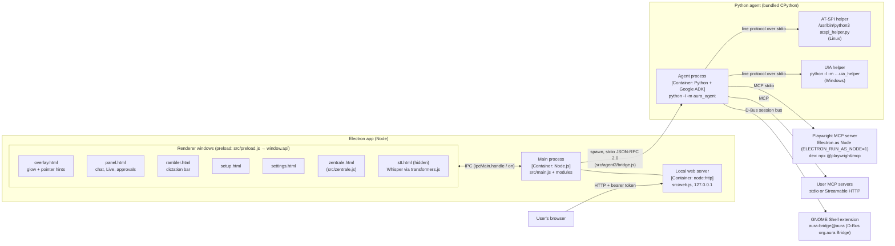
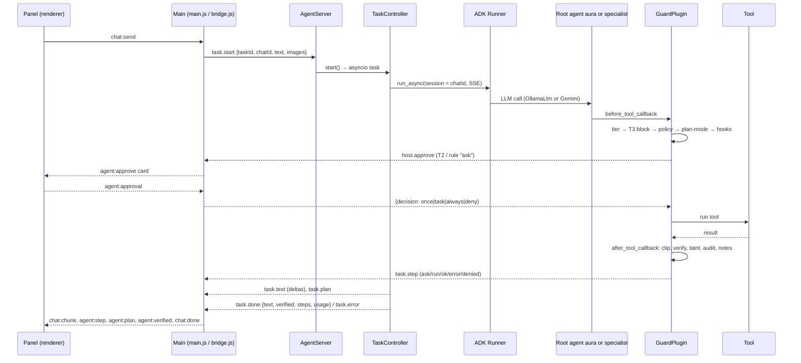

# Aura – Containers and components (C4 levels 2/3)

> Outside view (neighbours, trust boundaries, platforms): [context.md](context.md).
> Decisions: [docs/adr/](../adr/README.md). Jira story: AURA-28. LOC = lines at the time of writing.

## Process model



| Window | Created in | Purpose | Notes |
|---|---|---|---|
| overlay | `createOverlay` ([src/main.js](../../src/main.js)) | Screen-sized glow and Live pointer hints | click-through, content-protected; not shown on Wayland |
| panel | `createPanel` | Chat, dictation, Live, agent steps/approvals/questions | content-protected; closes on blur unless busy |
| rambler bar | `createRamblerBar` | Recording/processing state of Rambler | not focusable |
| setup | `openSetup` | First-run wizard (provider, key, budget / Ollama) | |
| settings | `openSettings` | Hotkeys, models, budget, autostart | unregisters hotkeys while focused |
| zentrale | `open` in [src/zentrale.js](../../src/zentrale.js) | Management UI | same page is served by [src/web.js](../../src/web.js) with [web-shim.js](../../src/renderer/web-shim.js) |
| stt (hidden) | `ensureStt` | Local Whisper (transformers.js, ONNX/WASM) | `show: false` |

All windows use [src/preload.js](../../src/preload.js) with `contextIsolation: true`.

## Electron components

| Module | Responsibility | LOC |
|---|---|---|
| [src/main.js](../../src/main.js) | App lifecycle, windows, tray, hotkeys, autostart, Rambler, screenshots, chat routing, v1/v2 agent routing, host callbacks for agent v2, Live/voice, Whisper jobs, Ollama status/pull, all non-`z:` IPC | 1149 |
| [src/preload.js](../../src/preload.js) | `window.api` bridge for all renderers (incl. `api.z.*`) | 116 |
| [src/store.js](../../src/store.js) | `settings.json` with defaults; Gemini key via `safeStorage`; profile prompt | 111 |
| [src/secrets.js](../../src/secrets.js) | Encrypted secret store `secrets.json`; resolves `${secret:NAME}` in MCP configs | 106 |
| [src/gemini.js](../../src/gemini.js) | Gemini REST: streaming chat, Rambler, transcription, key test | 134 |
| [src/ollama.js](../../src/ollama.js) | Ollama HTTP: chat, Rambler, local Live turn, model list/pull | 220 |
| [src/keys.js](../../src/keys.js) | Send Ctrl+C/V/Z (xdotool/wtype/ydotool; persistent PowerShell SendKeys) | 91 |
| [src/usage.js](../../src/usage.js) | Monthly Gemini cost estimate and budget (`usage.json`) | 72 |
| [src/chats.js](../../src/chats.js) | Chat history in `chats/<id>.json` (screenshots stripped) | 66 |
| [src/zentrale.js](../../src/zentrale.js) | Zentrale window + `API` object (MCP config, registry, skills, secrets, profile, …), registers `z:*` | 352 |
| [src/web.js](../../src/web.js) | Zentrale in the user's browser: HTTP on 127.0.0.1, token, Host/Origin checks, CSP | 135 |
| [src/agent2/bridge.js](../../src/agent2/bridge.js) | `AgentBridge`: locate Python, spawn agent, `initialize`, tasks, cancel, kill, restart on settings change, `agent.log` | 166 |
| [src/agent2/rpc.js](../../src/agent2/rpc.js) | Bidirectional JSON-RPC 2.0 peer over newline-delimited JSON (`PROTOCOL_VERSION = 1`) | 98 |
| [src/agent2/zentrale-v2.js](../../src/agent2/zentrale-v2.js) | Zentrale pages for v2: `policy.toml`, `MEMORY.md`, audit reader, doctor, GNOME extension install | 203 |
| [src/agent/](../../src/agent/) (v1) | In-process v1 agent: `loop.js` (175), `tools.js` (484), `mcp.js` (254), `skills.js` (128), `input.js` (100). `input.js` is also used for v2 `host.input`; `mcp.js`/`skills.js` back the Zentrale | 1141 |
| [src/renderer/](../../src/renderer/) | UI code; largest: `panel.js` (707), `zentrale.js` (470), `live.js` (285), `overlay.js` (210), `local-live.js` (196) | ~2.6k |

## Agent components (`agent/src/aura_agent/`)

| Package | Responsibility | Key files | LOC |
|---|---|---|---|
| [rpc](../../agent/src/aura_agent/rpc/) | JSON-RPC peer (mirror of `src/agent2/rpc.js`) | `peer.py` | 133 |
| [runtime](../../agent/src/aura_agent/runtime/) | `AgentServer` (RPC methods, `RpcHost`, `build_runner`, model warm-up), `TaskController` (session per chat, streaming, cancel, empty-answer and verify nudges), `TaskContext` (ContextVar), `AgentSettings` | `server.py`, `controller.py`, `context.py`, `settings.py` | 547 |
| [harness](../../agent/src/aura_agent/harness/) | `GuardPlugin` (tool boundary), tier model, user hooks, hash-chained audit log, `ContextManagerPlugin` | `guard.py`, `tiers.py`, `hooks.py`, `audit.py`, `context_manager.py` | 711 |
| [policy](../../agent/src/aura_agent/policy/) | Rules from `policy.toml` + Zentrale `toolPolicy`; bash/PowerShell classifiers; forbidden paths; exfiltration check | `engine.py`, `shell_classifier.py`, `powershell_classifier.py`, `paths.py`, `exfil.py` | 584 |
| [tools](../../agent/src/aura_agent/tools/) | Tool functions with `@aura_tool` tier metadata: files, shell, desktop/windows, apps, ui (a11y), pointer, screen, system (media, volume, gsettings), win_settings, memory, interaction (`todo_write`, `ask_user`), browser toolset | `files.py`, `system.py`, `desktop.py`, `browser.py` | 2010 |
| [platform](../../agent/src/aura_agent/platform/) | OS backends: X11, GNOME Wayland, Win32, AT-SPI/UIA helpers, Windows apps/audio/media/registry/shell, process groups | `x11.py`, `gnome_wayland.py`, `win32.py`, `atspi.py`, `uia_helper.py` | 1469 |
| [agents](../../agent/src/aura_agent/agents/) | Root agent `aura` (instruction, tools) and specialists `browser`, `apps` | `root.py`, `specialists.py` | 240 |
| [models](../../agent/src/aura_agent/models/) | `OllamaLlm` on native `/api/chat` ([ADR 0002](../adr/0002-custom-ollama-adapter.md)); tool-call repair | `ollama_llm.py`, `repair.py` | 428 |
| [memory](../../agent/src/aura_agent/memory/) | `MEMORY.md` facts (+ archive), secret filter | `store.py` | 107 |
| [extensions](../../agent/src/aura_agent/extensions/) | User MCP servers → `integrations` specialist; skills (`activate_skill`) | `mcp.py`, `skills.py` | 217 |
| [testing](../../agent/src/aura_agent/testing/) | Fakes for tests/evals: host, MPRIS, scripted LLM, GTK/Win test apps, notes MCP | | 430 |
| top level | `__main__.py` (stdio setup, `--selftest`, `--version`), `selftest.py` | | 132 |

## Agent request flow



1. **Entry.** `chat:send` ([src/main.js](../../src/main.js)) routes to v2 when `agentEnabled`, `agentVersion() === 'v2'`
   and a Python runtime is found; otherwise v1 (`src/agent/loop.js`) or plain chat. Live/voice uses `runVoiceTask`.
2. **Bridge.** `AgentBridge.ensure()` spawns the agent and sends `initialize` once (restarts when settings change
   and no task is running). `runTask` sends `task.start` and resolves on `task.done`.
3. **Controller.** [runtime/controller.py](../../agent/src/aura_agent/runtime/controller.py): one ADK session per
   `chatId` (SQLite), `max_llm_calls` 60, streaming text, one nudge for an empty answer, one honesty nudge if a
   success claim contradicts failed verification; episode text is added to the memory service.
4. **Agents.** [agents/root.py](../../agent/src/aura_agent/agents/root.py): root `aura` with built-in tools, memory
   tools, `activate_skill`, and specialists as `AgentTool`: `browser` (Playwright MCP,
   [ADR 0009](../adr/0009-browser-specialist.md)), `apps` (AT-SPI/UIA, [ADR 0010](../adr/0010-desktop-apps-via-at-spi.md)),
   `integrations` (user MCP servers). All share one model.
5. **Guard.** [harness/guard.py](../../agent/src/aura_agent/harness/guard.py) ([ADR 0003](../adr/0003-approvals-in-the-harness.md)):
   unknown tool → error; loop guard (warn at 3, stop at 5 identical calls); required args; tier (T3 → blocked);
   policy (`deny` > `ask` > `allow`, [policy/engine.py](../../agent/src/aura_agent/policy/engine.py)); plan-first for bulk
   requests; `before_tool` hooks; approval via `host.approve` (timeout 600 s → deny; `task` = rest of task,
   `always` = new rule in `policy.toml`); after the tool: verification (`verified`), taint marking and exfil inputs
   ([policy/exfil.py](../../agent/src/aura_agent/policy/exfil.py)), result clipping (12 000 chars), audit, `after_tool` hooks.
6. **Context.** `ContextManagerPlugin` trims images/old results within a task ([ADR 0004](../adr/0004-context-within-a-task.md)).
7. **Perception order:** API → accessibility → browser DOM → pixels ([ADR 0005](../adr/0005-perception-api-before-pixels.md)).

Default local model and evaluation: [ADR 0007](../adr/0007-local-default-model.md), [ADR 0008](../adr/0008-eval-suite.md).
Bundled Python: [ADR 0006](../adr/0006-bundle-python.md). Wayland/Windows: [ADR 0011](../adr/0011-wayland-gnome-extension.md), [ADR 0012](../adr/0012-windows-backend.md).

## IPC catalog (renderer ↔ main)

`invoke` = `ipcMain.handle` (request/response); `send` = `ipcMain.on` (fire-and-forget); `push` = main → renderer.

| Group | Channel | Kind | Purpose |
|---|---|---|---|
| Settings | `settings:get`, `settings:save`, `settings:testKey` | invoke | Read public settings; save (re-registers hotkeys, autostart, Whisper preload); test Gemini key |
| | `settings:open`, `setup:done`, `open:external` | send | Open settings; finish setup; open `https://` URL |
| Usage | `usage:get` | invoke | Monthly cost summary |
| | `live:usage` | send | Add Live minutes; stop Live over budget |
| Chat | `chat:send`, `chat:abort` | send | Start/abort a chat or agent task |
| | `chat:transcribe` | invoke | Dictation (Whisper locally, else Gemini `dictationModel`) |
| | `chats:list`, `chats:get`, `chats:save`, `chats:delete` | invoke | Chat history |
| Panel / overlay | `panel:hide`, `panel:busy`, `panel:ignoreMouse`, `glow:level`, `pointer:show`, `pointer:clear`, `overlay:idle` | send | Panel visibility, glow level, pointer hints |
| Agent | `agent:approval`, `agent:answer`, `agent:stop`, `agent:openLog`, `agent:openFile` | send | Approval decision, `ask_user` answer, emergency stop, open v1 log / `AGENTS.md` / skills / `mcp.json` |
| | `agent:voiceTask`, `agent:extensions` | invoke | Agent task from Gemini Live tool call; v1 extension status |
| Live | `live:config`, `live:turn` | invoke | Live config (incl. Gemini key) or one local Live turn |
| | `live:active`, `live:abortTurn` | send | Live state; abort local turn |
| Local models | `ollama:status`, `ollama:pull` | invoke | Ollama version/models; pull a model |
| | `ollama:abortPull` | send | Abort pull |
| STT window | `stt:ready`, `stt:result`, `stt:progress` | send | Hidden Whisper window → main |
| Rambler | `rambler:audio`, `rambler:cancel`, `rambler:undo`, `rambler:full`, `rambler:error` | send | Recording result and follow-up actions |
| Zentrale | `zentrale:open` | send | Open Zentrale window |
| Push (main → renderer) | `panel:open`, `panel:close`, `chat:chunk`, `chat:done`, `chat:error`, `chat:screen`, `agent:step`, `agent:approve`, `agent:ask`, `agent:plan`, `agent:verified`, `agent:stopped`, `usage:update`, `live:start`, `live:stop`, `live:heard`, `glow:mode`, `glow:level`, `pointer:show`, `pointer:clear`, `ollama:progress`, `stt:request`, `stt:preload`, `stt:progress`, `rambler:start`, `rambler:stop`, `rambler:state` | push | |

**`z:*` channels** (all `invoke`, registered by `register()` in [src/zentrale.js](../../src/zentrale.js); identical
functions are reachable via `POST /api/<name>` on the local web server):

| Group | Channels |
|---|---|
| State and log | `z:state`, `z:log`, `z:chats`, `z:deleteChat` |
| Agent switches | `z:setPolicy`, `z:setAgent`, `z:setAgentVersion` |
| MCP servers | `z:getServer`, `z:saveServer`, `z:removeServer`, `z:toggleServer`, `z:protectServer`, `z:searchRegistry`, `z:installRegistry` |
| Skills, AGENTS.md | `z:toggleSkill`, `z:getSkill`, `z:saveSkill`, `z:deleteSkill`, `z:saveAgentsMd` |
| Secrets | `z:secrets`, `z:setSecret`, `z:setSecretNote`, `z:deleteSecret` |
| Profile | `z:profile`, `z:saveProfile` |
| Agent v2 pages (from `zentrale-v2.js`) | `z:policy`, `z:savePolicy`, `z:memory`, `z:saveMemory`, `z:audit`, `z:doctor`, `z:installExtension` |
| Shell and web | `z:openPath`, `z:openUrl`, `z:openWeb`, `z:webInfo`, `z:resetWeb` |

## JSON-RPC catalog (main ↔ agent)

Schema: [protocol/aura-agent.schema.json](../../protocol/aura-agent.schema.json) (protocol version 1). Server side:
[runtime/server.py](../../agent/src/aura_agent/runtime/server.py); client side: [src/agent2/bridge.js](../../src/agent2/bridge.js).

| Name | Kind | Direction | Purpose |
|---|---|---|---|
| `initialize` | request | Electron → agent | Protocol check, settings, build runner; returns version, model, provider |
| `task.start` | request | Electron → agent | Start task `{taskId, chatId, text, images}` |
| `task.cancel`, `task.cancelAll` | request | Electron → agent | Emergency stop (2 s timeout, then hard kill) |
| `catalog.list` | request | Electron → agent | Built-in tools with tier (not called by Electron yet) |
| `policy.list` | request | Electron → agent | Rules listing (not called by Electron yet) |
| `ping` | request | Electron → agent | Liveness (not called by Electron yet) |
| `shutdown` | request / notification | Electron → agent | Cancel all, exit (bridge sends it as notification) |
| `host.approve` | request | agent → Electron | Approval card for T2 or rule `ask`; result `once`/`task`/`always`/`deny` |
| `host.ask` | request | agent → Electron | `ask_user` question with up to 5 options |
| `host.screenshot` | request | agent → Electron | JPEG of the current display |
| `host.input` | request | agent → Electron | Click / type / keys fallback (coordinates 0–1000) |
| `task.text` | notification | agent → Electron | Streamed answer delta |
| `task.step` | notification | agent → Electron | Tool step state `ask`/`run`/`ok`/`error`/`denied`, tier, `verified` |
| `task.plan` | notification | agent → Electron | `todo_write` list |
| `task.done`, `task.error` | notification | agent → Electron | Final text, `verified`, steps, ms, usage / error |
| `model.status` | notification | agent → Electron | Ollama warm-up `loading`/`ready`/`error` (main.js passes no `onModelStatus`, so it is ignored) |

## Configuration flow

```
settings.json (src/store.js, userData)  ─┐
~/.aura/mcp.json + secrets.json  ────────┼─> AgentBridge settings() in src/main.js ─> initialize.settings
                                          │        (re-sent and agent restarted when the JSON changes)
                                          └─> AgentSettings.from_params (runtime/settings.py)
~/.aura/policy.toml, hooks.json, AGENTS.md, skills/, memory/  ─> read directly by the agent
```

Mapping: `provider`, `chatModel → geminiModel`, `getApiKey() → geminiApiKey` (Gemini only), `ollamaModel → model`,
`ollamaUrl`, `ollamaContext → numCtx`, `language`, `profilePrompt() → profile`, `sessionType`, `toolPolicy`,
`browserCommand`/`browserEnv` (bundled Playwright MCP), `mcpServers` (secrets resolved), `disabledSkills`,
`dataDir = <userData>/agent`, `auraDir = ~/.aura`.

**Known issue – inconsistent defaults (Jira AURA-41).** Electron and agent disagree on defaults; only the Electron
values reach the agent in practice, but the agent defaults apply in tests, evals and when a field is missing:

| Setting | [src/store.js](../../src/store.js) | [runtime/settings.py](../../agent/src/aura_agent/runtime/settings.py) |
|---|---|---|
| provider | `gemini` | `ollama` |
| Ollama model | `gemma4:e4b` | `gemma4:26b` (ADR 0007) |
| context | `ollamaContext: 16384` | `num_ctx: 16384` (doctor warns below 32768) |

## Data locations

`<userData>` = `~/.config/Aura` (Linux), `%APPDATA%\Aura` (Windows).

| Path | Owner | Content |
|---|---|---|
| `<userData>/settings.json` | store.js | Settings, encrypted Gemini key (`apiKeyEnc`) |
| `<userData>/secrets.json` | secrets.js | Encrypted MCP secrets (mode 0600) |
| `<userData>/usage.json` | usage.js | Monthly cost estimate |
| `<userData>/chats/` | chats.js | Chat history (no images) |
| `<userData>/agent-log.jsonl` | v1 loop.js | v1 agent log |
| `<userData>/agent/agent.log` | bridge.js | Agent stderr (rotated at 5 MB) |
| `<userData>/agent/sessions.db`, `memory.db` | agent | ADK sessions per chat; conversation search |
| `<userData>/agent/audit/YYYY-MM.jsonl` | harness/audit.py | Hash-chained audit log, secrets redacted |
| `<userData>/agent/browser/` | tools/browser.py | Playwright output |
| `~/.aura/mcp.json` | Zentrale / user | MCP servers (`${secret:NAME}` references) |
| `~/.aura/policy.toml`, `hooks.json` | user / "always allow" | Rules and hooks |
| `~/.aura/AGENTS.md`, `skills/` (+ `~/.agents/skills`) | user | Instructions and skills |
| `~/.aura/memory/MEMORY.md`, `archiv.md` | agent / user | Remembered facts |
| `~/.aura/browser-profile/` | Playwright | Own Chrome/Edge profile |
| `~/.local/share/gnome-shell/extensions/aura-bridge@aura` | zentrale-v2.js | GNOME extension |

## Known architectural debts

| Debt | Description | Jira |
|---|---|---|
| v1 agent still shipped | `src/agent/` (in-process JS agent) still selectable via `agentVersion: 'v1'` and used as fallback without Python; parts reused by v2 (`input.js`) and the Zentrale (`mcp.js`, `skills.js`, `tools.js`) | AURA-39 |
| `main.js` god module | 1149 lines mixing windows, Rambler, chat, agent host, Live, STT, Ollama, hotkeys, tray | AURA-40 |
| Inconsistent defaults | See configuration flow | AURA-41 |
| No TypeScript | Electron side is untyped CommonJS; RPC types exist only as JSON Schema | AURA-42 |
| Project language | Code comments, UI strings, ADRs and prompts are German; English as project language | AURA-38 |
