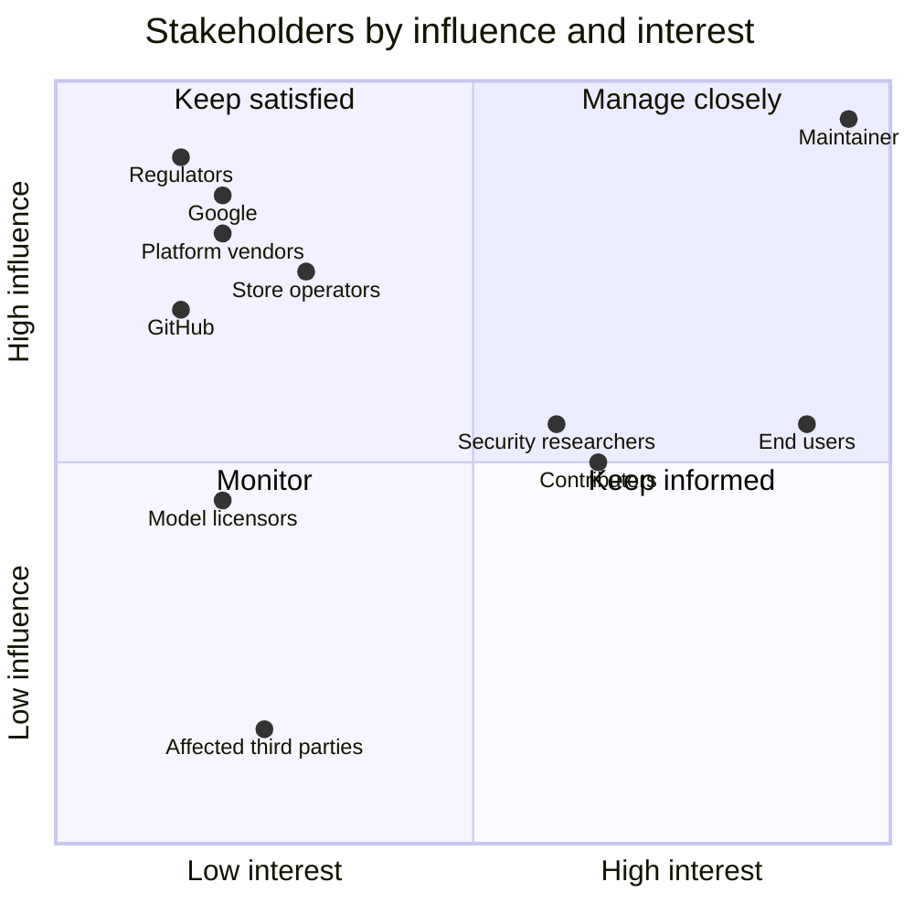

# Stakeholder analysis

Status: draft for review (AURA-26) · Last updated: 2026-10-12

Who has an interest in Aura or is affected by it, what they expect, and how much they can influence it.
The needs derived from this analysis are in [needs.md](needs.md); the requirements in
[system-requirements.md](../requirements/system-requirements.md) trace back to them.

## End-user personas

| ID | Persona | Context | Wants | Frustrated by | Implications for Aura |
|---|---|---|---|---|---|
| P1 | **Mia, everyday laptop user** | Windows 11 laptop, not technical, German or English | "Just tell the computer what I need": find a document, change a setting, play music, write a quick text | Hidden settings, jargon, fear of breaking something, dialogs she doesn't understand | Plain-language answers and approval cards; no destructive action without a clear question; easy install and automatic updates; works with Gemini (no GPU) |
| P2 | **Jonas, power user and developer** | Ubuntu with GNOME, strong GPU, uses the terminal | Automate repetitive work (files, windows, browser, commands), extend Aura with MCP servers and skills, local models | Assistants that are slow, opaque or need the cloud; tools that hide what they do | Transparent tool steps and audit log, rules (`policy.toml`), hooks, MCP, skills; fast local models; good docs to contribute |
| P3 | **Lea, privacy-first user** | Linux or Windows, refuses cloud AI for personal data | Help from AI without data leaving the machine; proof of what happens | Hidden telemetry, unclear data flows, accounts | Local mode as a first-class default; no telemetry; documented data flows; offline after setup; clear consent before any cloud use |
| P4 | **Sam, macOS user** | MacBook (Apple silicon), English | A native-feeling assistant that respects macOS permissions | Apps that ask for every permission at once or break after updates | macOS backend, guided permission setup (Screen Recording, Accessibility, Microphone), signed and notarized app |
| P5 | **Karl, user with motor or visual impairment** | Keyboard and voice, screen reader | Operate the computer by voice and keyboard; reliable feedback | Mouse-only UIs, unlabeled buttons, animations | Full keyboard and voice operation, ARIA labels, live regions, reduced motion, high contrast (WCAG 2.2 AA) |
| P6 | **Ana, multitasker using voice** | Busy hands (cooking, handwork), any OS | Ask by voice, short spoken answers | Having to go back to the keyboard to approve | Live/voice mode with short answers; consequential actions still need approval, explained clearly |

## Stakeholder register

| Stakeholder | Type | Interest | Influence | Expectations | Concerns / risks | Engagement |
|---|---|---|---|---|---|---|
| End users (P1–P6) | Primary | High | Medium (adoption, feedback) | Useful, safe, honest, easy | Damage to their data or system; privacy | Issues and Discussions; usability tests; release notes |
| Maintainer | Project owner | High | High | Sustainable quality, reputation, low maintenance cost | Burn-out, security incidents, legal risk | Roadmap, ADRs, automation (CI, Dependabot, release-please) |
| Contributors | Project | Medium | Medium | Clear docs, quick reviews, welcoming process | Unclear architecture, German-only code, slow CI | CONTRIBUTING, English as project language, good-first-issue labels, devcontainer |
| Security researchers | Project | Medium | Medium | Private reporting, timely fixes, credit | Being ignored; public disclosure without a fix | SECURITY.md, private vulnerability reporting, advisories |
| Distribution and store operators (Debian/Ubuntu users of the apt source, Debian extrepo, winget, Homebrew, SignPath Foundation, Apple notarization) | Gatekeepers | Low–medium | High for their channel | Policy-compliant packages, stable signing, responsive maintainer | Malicious or broken packages | lintian-clean packages, signed and attested builds, documented signing policy |
| Google (Gemini API, Google ADK, trademarks) | Provider | Low | High | Use of APIs within terms; no confusion with Google products | Trademark misuse ("Gemini" branding), abuse of API | Own name and icon, trademark notice, follow API terms, pin ADK versions |
| Ollama and model licensors (Gemma terms, Qwen etc.) | Provider | Low | Medium | License compliance | Using models outside their terms | Document model licenses; user chooses the model |
| Hugging Face | Provider | Low | Low | Fair use of model downloads | — | Cache models, pin revisions |
| Platform vendors (Microsoft, Apple, GNOME/Canonical) | Platform | Low | High | Use of public APIs, respect for security model | Apps abusing accessibility or input APIs | Use official APIs (UIA, AX, AT-SPI, portals), least privilege |
| GitHub | Infrastructure | Low | High | Use within ToS (Actions, Pages bandwidth) | Abuse, excessive bandwidth | Minimal Actions permissions, artifact retention, Pages within limits |
| Third parties affected by agent actions (recipients of messages, website operators) | Affected | Low | Low | No spam, no abuse, respect for ToS | Unwanted messages or purchases | Sending/buying is always T2 (asks); browser specialist rules |
| Legislators and regulators (GDPR, EU AI Act, product liability, trademark law) | Regulator | Low | High | Lawful processing, transparency | Fines, liability | Privacy docs, local-first, transparency about AI, MIT disclaimer, legal review where needed |

## Influence / interest map

## Key conflicts and how we resolve them

| Conflict | Resolution |
|---|---|
| Convenience (P1, P6 want fewer questions) vs. safety | Tier model: reading and reversible actions run directly; consequential ones ask with a clear effect description; "always allow" creates an explicit, editable rule |
| Power (P2 wants shell, MCP, hooks) vs. safety for P1 | Same guard for everything (MCP and hooks included); forbidden tier T3 cannot be unlocked by rules |
| Cloud quality (Gemini) vs. privacy (P3) | Local is the default; cloud only by explicit choice with a visible indicator; budget limit |
| Fast releases vs. distribution gatekeepers | Automated release with tests, signing and provenance; packages pass lintian / notarization in CI |
| One-person maintenance vs. three platforms | Shared tool layer with thin platform backends; contract tests per platform in CI |
